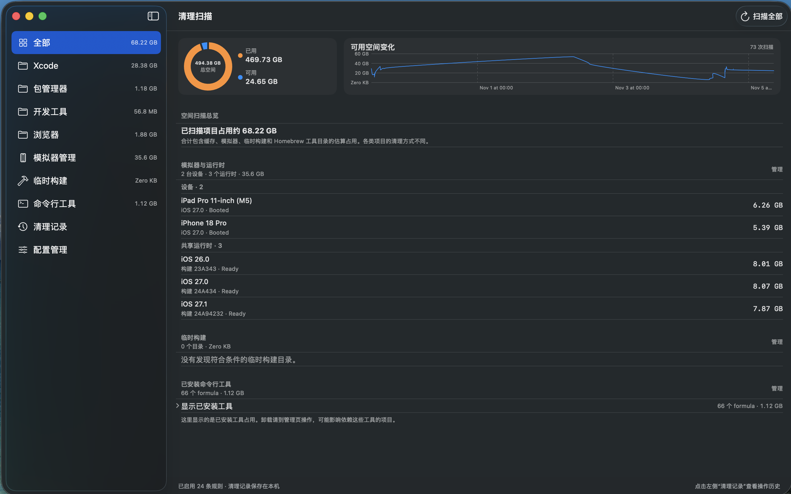

# CleanUpForMacOS

[简体中文](README.md) | **English**

 [](https://github.com/13098806890/MacosStorageManager/releases)


CleanUpForMacOS is a macOS storage management tool for developers. It helps review development caches, Xcode Simulators, and temporary build directories, and manage Homebrew formulae. You start every scan. Ordinary cleanup shows an estimate and impact first, then moves selected items to Trash after confirmation.

[Download the macOS app](https://github.com/13098806890/MacosStorageManager/releases/download/v0.1.0/CleanUpForMacOS-0.1.0.dmg) · [All releases](https://github.com/13098806890/MacosStorageManager/releases) · [Report an issue](https://github.com/13098806890/MacosStorageManager/issues)

The current stable version is **0.1.0** for **macOS 14 or later**. It is signed with Developer ID and notarized by Apple. The app is distributed directly and is not compatible with the Mac App Store.

## Features

- **Development cache cleanup:** Manually scan configured cache directories, review their descriptions, cleanup impact, and estimated sizes, then choose targets. Expand folders to inspect visible subdirectories. Ordinary cleanup requires confirmation and moves items to Trash.
- **Multiple cleanup profiles:** Import and export profiles, then enable rules individually. Imported rules are disabled by default; each profile file contains one role.
- **Xcode Simulator management:** Review devices, data, and runtime sizes. Deleting a device permanently removes it and its data. A runtime can be removed through `simctl` after confirmation; it cannot be removed while devices still reference it, and can be downloaded again from Xcode.
- **Temporary build directories:** Inspect direct child directories under `/private/tmp` that belong to the current user and contain many compiler outputs. Selected directories move to Trash after confirmation; future builds may need to regenerate those outputs.
- **Homebrew management:** Manually refresh the formula list, view versions and install sizes, and search, install, upgrade, pin/unpin, or uninstall formulae. Every package change requires confirmation.
- **Disk space and local records:** View the capacity of the volume containing the home folder and available-space history recorded after manual scans. Profiles, history, and cleanup logs stay on this Mac.

## Screenshot



## Download and use

Download the DMG from [GitHub Releases](https://github.com/13098806890/MacosStorageManager/releases), open it, and drag the app to **Applications**. On first use, enable the rules you want in **Configuration Management**, return to **All**, and start a scan manually. Review the target description, estimate, and confirmation dialog before taking action.

Scan sizes are estimates, not file inventories. The scanner does not show filenames and skips hidden files, so displayed sizes may be lower than actual directory usage. Before cleanup, the app rechecks metadata captured during the scan. Read failures or changed targets invalidate the old result and require a fresh scan. Cache and temporary build cleanup move items to Trash; simulator device deletion is permanent.

## Safety and privacy

App Sandbox is disabled so the app can access approved cache directories in the current user's home folder and manage temporary build artifacts in the fixed `/private/tmp` location. Cleanup paths are limited to static paths under `$HOME/`; at runtime the app checks approved cache roots, the home-folder boundary, and symlinks. Imported profiles cannot expand the allowlist. Do not import profiles from untrusted sources or assume a directory is safe based only on its name.

Profiles, disk history, and cleanup logs are stored in the current user's Application Support directory. Cleanup logs contain resolved local absolute paths; do not share an unredacted log publicly. See [`docs/SAFETY_VALIDATION.md`](docs/SAFETY_VALIDATION.md) for validation boundaries and [`AGENTS.md`](AGENTS.md) plus [`docs/AI_RULE_AUTHORING.md`](docs/AI_RULE_AUTHORING.md) for cleanup rule requirements. The privacy manifest is [`Config/PrivacyInfo.xcprivacy`](Config/PrivacyInfo.xcprivacy).

## Build from source

Requirements: macOS 14 or later, Xcode 15 or later, and the Xcode Command Line Tools selected in Xcode **Settings > Locations**.

```sh
git clone https://github.com/13098806890/MacosStorageManager.git
cd MacosStorageManager
xcodebuild \
  -project CleanUpForMacOS.xcodeproj \
  -scheme CleanUpForMacOS \
  -destination 'platform=macOS' \
  CODE_SIGNING_ALLOWED=NO \
  build
```

You can also open `CleanUpForMacOS.xcodeproj` in Xcode, select the `CleanUpForMacOS` scheme, and build or run. GitHub Actions validates the bundled profile, runs safety regression tests, and builds the macOS app; an ordinary commit does not automatically publish a new release.

## Repository layout

```text
Sources/
├── App/                         # App entry point, window, and main navigation
├── OperationSupport.swift      # Cancellation, process runner, and directory fingerprints
└── Features/
    ├── Cleanup/                 # Cache rules, scan/cleanup state, and views
    ├── Homebrew/                # Homebrew inventory, actions, and UI
    ├── Simulator/               # Simulator device and runtime management
    └── TemporaryBuilds/         # Temporary build directory inventory
Config/                           # Bundled profile and privacy manifest
Assets/                           # App icon resources
scripts/                          # Profile validation utility
Tests/                            # Cleanup safety regression tests
.github/workflows/                # GitHub Actions CI
docs/                             # Architecture, safety, release, and versioning docs
```

## Contributing and project docs

Contributions to code, documentation, accessibility, localization, and evidence-backed cleanup rules are welcome. Start with [`CONTRIBUTING.md`](CONTRIBUTING.md), [`docs/ARCHITECTURE.md`](docs/ARCHITECTURE.md), and [`SECURITY.md`](SECURITY.md). Versioning, release steps, and signing requirements are in [`docs/RELEASING.md`](docs/RELEASING.md).

**License not yet selected:** There is no `LICENSE` file, so redistribution and reuse terms have not been established. The project does not currently claim to provide software licensed for reuse.
