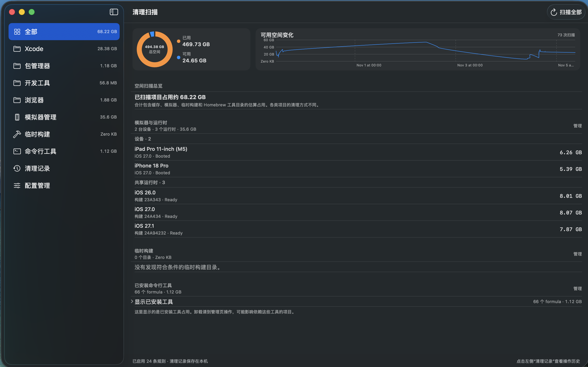

# CleanUpForMacOS

**简体中文** | [English](README.en.md)

一个面向开发者的 macOS 存储整理工具。由你主动扫描、检查说明和空间估算、选择目标；普通清理会先移到废纸篓，需要再次确认，不会静默或定时删除。

[下载 CleanUpForMacOS 0.1.0 DMG](https://github.com/13098806890/MacosStorageManager/releases/download/v0.1.0/CleanUpForMacOS-0.1.0.dmg) · [查看所有版本](https://github.com/13098806890/MacosStorageManager/releases)

> **当前版本：** `0.1.0`，已使用 Developer ID 签名并通过 Apple 公证。安装包适用于 macOS 14 或更新版本，不适用于 Mac App Store。

## 功能一览

- **空间总览：** 查看磁盘剩余空间，以及每次扫描后的空间变化。
- **缓存清理：** 按 Xcode、包管理器、开发工具和浏览器分类查看占用，选中需要清理的项目。
- **模拟器管理：** 查看并移除不再使用的 Xcode 模拟器和运行时。
- **临时构建清理：** 找出遗留的临时构建文件，释放磁盘空间。
- **命令行工具管理：** 查看 Homebrew 工具占用，搜索、安装、升级、固定版本或卸载工具。
- **配置与记录：** 选择扫描项目、导入配置，并查看保存在本机的清理记录。

## 截图



## 使用方法

从 [GitHub Releases](https://github.com/13098806890/MacosStorageManager/releases) 下载 DMG，打开后将应用拖到 **Applications（应用程序）**。

1. 在“配置管理”中启用需要扫描的项目。
2. 点击“扫描全部”，查看各类别的空间占用。
3. 阅读项目说明和清理影响，按需展开子文件夹、选择目标。
4. 确认后清理。缓存和临时构建会移到废纸篓；模拟器、运行时和命令行工具请到对应管理页面操作。

> **清理前请留意：** 缓存可能需要重新下载或生成，建议先退出相关应用。模拟器设备删除不可恢复，请提前保存需要的数据。扫描大小为估算值，可能不包含隐藏文件。

## 构建

要求：macOS 14 或更新版本、Xcode 15 或更新版本，并在 Xcode **Settings > Locations** 中选择 Xcode Command Line Tools。

```sh
git clone https://github.com/13098806890/MacosStorageManager.git
cd MacosStorageManager
xcodebuild \
  -project CleanUpForMacOS.xcodeproj \
  -scheme CleanUpForMacOS \
  -destination 'platform=macOS' \
  CODE_SIGNING_ALLOWED=NO \
  build
```

也可以在 Xcode 中打开 `CleanUpForMacOS.xcodeproj`，选择 `CleanUpForMacOS` scheme 后构建或运行。项目使用直接分发配置，不适用于 Mac App Store。

## 隐私与安全

扫描由你主动发起，清理前需要确认。配置、空间历史和清理记录保存在本机，不会上传到项目服务；分享清理记录前请移除其中的个人路径。

应用需要访问缓存目录，未启用 App Sandbox，仅供直接下载安装。请只导入可信配置，并在清理前核对目标和影响。隐私清单见 [`Config/PrivacyInfo.xcprivacy`](Config/PrivacyInfo.xcprivacy)。

## 参与贡献

欢迎提交代码、文档、无障碍和本地化改进，以及有充分证据的规则提案。请先阅读 [`CONTRIBUTING.md`](CONTRIBUTING.md) 和 [`docs/ARCHITECTURE.md`](docs/ARCHITECTURE.md)。安全问题请按 [`SECURITY.md`](SECURITY.md) 中的方式报告。

**许可证尚未确定：** 仓库目前没有 `LICENSE` 文件。许可证确定前，代码的再分发和复用条款尚未建立；详情见 [`CONTRIBUTING.md`](CONTRIBUTING.md)。

## 项目维护文档

- [版本策略与发布流程](docs/RELEASING.md)：版本号、构建号、发布检查项与分发签名要求。
- [AI 贡献者指南](docs/AI_CONTRIBUTING.md)：AI 开始修改前必须阅读的项目边界、工作流程和验证要求。
- [清理规则作者指南](docs/AI_RULE_AUTHORING.md)：新增或修改任何清理路径前必须阅读的专门安全规范。
